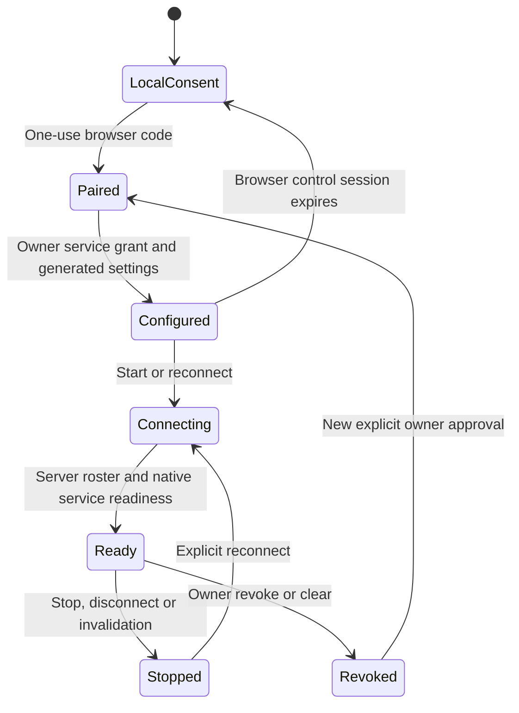

# Minecraft player bridge

One Mineflayer player client connects a selected player to an IfSoul character
through private text whispers. Games own movement, combat, pathfinding and actions;
the bridge forwards bounded dialogue and observations.

Verified private Minecraft whisper through installed IfSoul Desktop and local
Ollama. The connector accepts only the approved player's private whisper,
tracks roster/spawn and lifecycle changes, and returns one private reply.
It does not target native server NPCs, group dialogue or public chat.

## Install

Use Node22.18–24 and pnpm10.15.0:

```sh
git clone https://github.com/openifsoul/bridge-minecraft.git
cd bridge-minecraft
pnpm install --frozen-lockfile
pnpm check
```

The repository includes its public SDK dependency and a checksum/source receipt.

## Configure through the App

Run `pnpm companion`, open `http://127.0.0.1:8811`, and explicitly approve the App origin you opened yourself. In the App's **Games → Configure Minecraft → Mineflayer**, enter the one-use local code, select the independent Minecraft server address, bot/player names, owned character/memory and available provider, approve private dialogue, and save/start. The companion generates and persists validated settings; no JSON, UUID or token editing is needed.

The browser does not install or launch the native companion. The one-time installation above requires three preparation commands and `pnpm companion` launches it. Later launches require only `pnpm companion`. Keep that terminal running. The companion binds only literal loopback and accepts an exact locally approved App origin. It has no arbitrary command/file endpoint. Provider keys remain in the selected service.

This path supports authorized Java Minecraft1.20.2 servers in explicit trusted offline mode. It does not alter server authentication or implement Microsoft sign-in. The selected player's UUID is discovered from the actual server roster. IfSoul service and Minecraft TCP endpoints are separate; service HTTPS is required except for loopback HTTP. The companion connects outbound to local/self-hosted/managed service device routes; a cloud service cannot dial your localhost.

Use App **Start**, **Stop**, **Reconnect**, **Clear** and **Revoke**. The native credential expires after one hour; renew through the App. Stop/reconnect fence pending work and never replay uncertain sends. Clear requests remote revocation before removing local settings; unavailable remote confirmation is reported. Re-approving another App origin redacts the previous binding and requires explicit clear, without copying memory. Same-target/profile/memory provider renewal preserves the server-owned host identity and private memory.

Generated settings live under `~/.ifsoul/minecraft` with restricted permissions; operators can set `IFSOUL_COMPANION_DATA_DIR`. Unsupported stored configuration fails without changing it. Only approved private whispers reach the selected character, and output remains a short non-command line. Movement, combat and game mechanics stay with Minecraft.



## Advanced file-driven local test

The original CLI remains available for developer-operated isolated tests:

Use a loopback Java Minecraft1.20.2 server with pinned Mineflayer4.39.0 and a
compatible Java runtime. The CLI does not download a server, Java runtime or model,
accept a Minecraft EULA or launch a graphical game client. Follow server terms
and use a server you have permission to connect to.

Copy config.example.json to ignored config.local.json. Set the loopback port,
exact server player UUID/name, world alias and an original character. The
isolatedOfflineServerApproved option explicitly selects the isolated offline
server trust model. The player name is checked against its current UUID on every
request/send. Private-whisper parsing assumes a trusted server and plugins.

```sh
pnpm start -- config.local.json
```

After ready, the selected player sends `/tell TaviBot hello`. Stop with Ctrl-C.
Public chat and unrelated whispers are ignored. Death, dimension changes and
recipient departure invalidate pending work; a playable spawn starts a new
connection. Reconnect manually; uncertain sends are not replayed automatically.

For App mode, start the public App on loopback, select a profile and memory, and
configure an installed provider/model. Set app, provider, model and the returned
profile/memory IDs in the bridge configuration; retain memoryId across reconnect.
Calls are bounded by maxCalls1–10, one in-flight call, queue size2, cooldown and a
deadline. Above60000ms (maximum150000), bridgeLimits.timeoutMs must match the
deadline and App capabilities must accept the configured budget.

Output is one line, at most180characters, without control/format characters or a
leading slash. App owns persistent memory; SDK observations are a bounded local
history. Local cancellation does not guarantee that provider-side work or charges
have stopped. Keep credentials, conversations, saved worlds and logs outside Git.

See [setup reference](docs/fresh-pc.md) and [configuration example](config.example.json).

## Development checks

`pnpm check` runs syntax, version and deterministic fixtures. The optional local
protocol harness uses a supplied server directory:

```sh
IFSOUL_MC_SERVER_DIR=/absolute/path/to/disposable-server \
IFSOUL_DISPOSABLE_TEST_APPROVED=yes node scripts/native-safety.mjs
```

The harness creates its own clients/server and closes them after checking lifecycle,
queue, timeout and private-message behavior. It sends no model requests.
